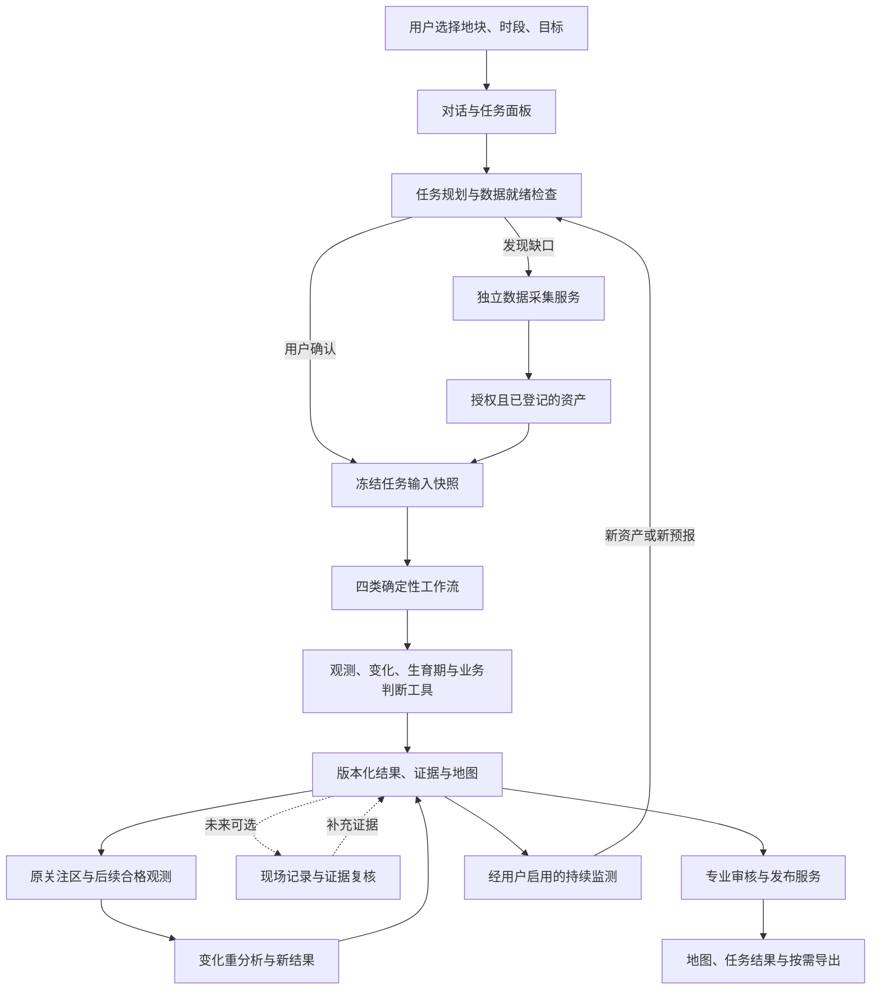

# 黑土农情 Agent 工具体系完整设计

> 更新日期：2026-10-18。状态：待实施设计，不代表新增能力已上线或通过田间验证。
> 当前条件：现阶段不假定能够取得巡田、农事、实测或现场阶段记录；这些材料仅作为未来可选增强。
> 范围：玉米、单地块任务、四类农情能力，以及数据准备、遥感变化追踪、后续观测复查和持续监测闭环。
> 当前实现以 `packages/contracts/src/index.ts`、`packages/agent-runtime/src/skill-runner.ts` 和实际服务代码为准；[现有工具设计](agent-tool-design.md)与[现有契约](ai-tool-contracts.md)描述当前基线。本文是增量设计的单一事实来源，实施后将相应内容迁入正式契约，删除失效设计，不并行维护两套规则。

## 1. 产品终点与设计决策

用户选择农田、时段和任务后，应能回答五个问题：观测到什么情况，哪里存在差异，何时发生变化，判断依据是什么，下一步如何继续跟踪。新影像到达后，系统应说明原关注区的观测特征是否持续、减弱、恢复或暂不可观察。现场核查可作为建议动作，但记录回传不作为当前任务完成的条件。

保留一个黑土农情 Agent、四个业务入口。当前实施目标是保留并增强现有十个工具，只新增 `analyze_field_change`，共十一个分析工具。`reconcile_field_observations` 延后到确有现场材料和独立复核需求时再实现，完整扩展目录共十二项。数据准备、专业审核、订阅和报告由领域服务承担；现有巡田记录能力保留为可选入口，不扩大建设新的核查平台。

首批交付优先完成“多期观测 → 空间变化 → 多源解释 → 下一期观测复查”，其他三项沿用同一证据链逐项验收。不同来源一致可以增强判断，但不能替代田间真值；遥感特征恢复也不等于病因排除或农事效果得到验证。实施按第 13 节分段推进。

### 1.1 当前基线与目标差异

| 环节 | 当前代码基线 | 目标行为 |
| --- | --- | --- |
| 数据 | 六类来源已有采集、登记和处理路径；可用性取决于实际权限、产物与质量 | 按任务所需角色检查缺口，只补必要数据，所有来源保留许可与版本 |
| 光学 | 多指标观测、日期均值差、最新日期相对分区 | 保留观测；新增共同有效像元上的空间变化与持续性 |
| 长势 | 光学 + 播后天数阶段 + 固定工程规则 | 区分光谱变化、阶段变化和经验证的异常；按条件加入雷达、天气 |
| 水氮 | 多源规则与显式选择的巡田线索 | 当前交付光谱差异、水分相关线索和候选解释；缺氮原因保持未确认，不依赖补录现场记录才能看结果 |
| 积水 | 雷达前后变化 + 降雨关联 + 地形排序 | 改善实际空间对齐、面积口径和植被覆盖场景验证，追踪退水 |
| 霜冻 | 单次预报风险工作流 | 新预报驱动更新，有效期、升级、解除和过期各有语义 |
| 后续复查 | 有历史任务和单期结果，缺完整跨期关联 | 用下一期合格观测复查原关注区；现场记录与复核作为延后增强 |
| 专业审核 | 有 `needs_review`，施氮候选方案只保存该状态 | 审核、修订、拒绝、批准和失效可追踪，发布与审核状态一致 |
| Agent | 受控对话门面，模型不直接执行底层工具 | 继续隐藏算法细节，增加历史比较和核查计划读取 |
| 交付可信度 | 有测试替身、算法测试和任务持久化 | 增加真实授权地块验收、方法适用范围与版本回归 |

“实现存在”“工程测试通过”“真实地块验收通过”“农学方法验证通过”分别记录。工具返回 `succeeded` 只表示本次计算达到契约，不表示方法已经具有田间诊断准确率。

## 2. 总体结构与所有权



| 模块 | 拥有的职责 | 向上暴露的接口 |
| --- | --- | --- |
| API | 身份与地块权限、请求 schema、幂等键、响应 | 领域命令与查询；不选择算法 |
| Agent/domain | 目标解析、计划、固定依赖、冻结 scope、执行、失败恢复 | 任务计划、进度、结果、缺口、下一步 |
| Acquisition | 许可、发现、下载、缓存、重试、manifest | 按数据角色准备与登记资产；不作为模型工具 |
| Remote sensing | 质量门、对齐、观测、空间变化、背景和判断 | 当前目标十一个受控工具；现场复核工具延后 |
| Field evidence | 当前仅消费实际存在的种植资料；作业、实测和核查扩展延后 | 缺资料保持未知，不生成假定记录、不自行确认农业原因 |
| Review/delivery | 候选建议审核、修订、发布、报告版本 | 审核状态与可交付结果 |
| Monitoring | 订阅、触发、任务去重、预警事件及有效期 | 订阅状态与预警变化；不直接推断风险 |
| Store | 主体隔离、持久化、产物索引、数据保留 | 仓储访问；不编排任务 |
| Frontend | 地图、输入、进度、证据、巡田与导出 | 展示后端事实；不重复质量或诊断算法 |

保持模块化单体、现有 Fastify/TypeScript 和 Python JSON worker。先在现有模块内建立清楚的接口，实际产生独立复杂度后再拆文件；不新增微服务、通用插件市场或 GIS 工具平台。

## 3. 用户入口与对话门面

### 3.1 四个业务入口

| 入口 | 默认目标 | 交付内容 | 直接动作 |
| --- | --- | --- | --- |
| 长势监测 | 当前长势及本季变化 | 日期、生育期范围、当前差异、实际变化区、持续性 | 查看变化地图、生成核查清单、下期跟踪 |
| 水氮管理 | 查看水分与养分相关观测线索 | 光谱差异、水分相关支持、候选原因、未确认事项 | 对比多指标与日期、继续观测；现场核查仅作为可选建议 |
| 积水识别 | 降雨过程前后疑似积水 | 前后观测、降雨事件、疑似区与面积、核查优先级 | 核查积水与排水、记录退水、再次分析 |
| 霜冻预警 | 未来有效窗口的风险 | 预报批次、触发窗口、可支持的阶段敏感性、地形关注区 | 查看依据、比较新预报、启用或暂停持续预警 |

“复核现场记录”和“与上次比较”是结果页后续动作，不再增加第五个一级能力。“施氮方案”保留为水氮管理的独立二级动作。

### 3.2 对话门面目录

这是领域层可解释的受控操作，不等于把所有函数注册进 Codex SDK。首版继续沿用当前确定性识别与服务端调用；只有确有必要时才改变模型运行时装配。

| 门面 | 状态 | 输入边界 | 返回与完成条件 |
| --- | --- | --- | --- |
| `get_field_context` | 增强现有 | 当前地块 + 受约束焦点 | 档案、作业/实测摘要、数据就绪、最近任务；无越权几何或原始资产 |
| `get_task_result` | 增强现有 | 当前地块内的任务选择与焦点 | 已发布版本、数据日期、实际变化、证据和动作；最新未完成任务不被旧任务替代 |
| `search_agronomy_knowledge` | 保留 | 已授权任务/地块 + 查询 | 有出处的农学解释；无索引时明确不可用，不改变分析结论 |
| `plan_workflow` | 增强现有 | 地块、目标、时段、用户需求 | 数据角色、缺口、可交付范围、固定计划和确认请求；不启动任务 |
| `start_workflow` | 增强现有 | 已确认的计划引用/版本 + 幂等键 | 任务 ID；计划已失效或输入变化时重新展示计划，不静默改范围 |
| `get_workflow_status` | 保留并增强 | 当前地块的任务选择 | 当前步骤、已完成产物、缺口、失败与可恢复动作 |
| `record_scouting_note` | 增强现有 | 结构化草稿 | 地块内位置、日期、观察与可选附件；用户确认后才保存 |
| `compare_task_results` | 新增只读 | 同地块两个已发布任务的选择 | 可比/部分可比/不可比、共同范围、差异和原因；不将摘要相减当成重分析 |
| `get_scouting_plan` | 延后 | 当前任务 | 有真实现场反馈需求后再提供核查计划；不作为当前任务依赖 |

作业记录、实测录入、订阅、专业审核与导出先使用结构化界面/API，不增加对话写工具。当前地块由会话绑定；历史任务选择必须能在界面中辨认日期和目标，模型不能猜内部 ID。

### 3.3 一次普通任务的交互

1. 选田，展示当前可用数据日期与已知资料，不要求用户选择波段或数据产品。
2. 选目标与时段。计划只展示分析范围、预期交付和需要补充的必要资料。
3. 点击确认。现有资产足够则启动；不足时让用户确认准备所需数据，采集服务独立执行。
4. 展示“准备资料 → 分析观测与变化 → 形成结果”的进度，技术步骤可展开。
5. 结果默认展示“当前状态、空间分布、历史变化、依据、建议操作”。单期仅展示当前差异，变化栏说明缺少可比时相。
6. 用户查看原关注区的后续观测与变化。新观测可用时确认创建关联重分析任务；持续监测订阅启用后可在授权范围内触发。原任务保留；有现场材料时才显示补证与现场复核分支。

## 4. 统一输入、结果与方法契约

本节定义拟新增语义，不复制现有 `AnalysisResult` 的完整 TypeScript schema。实施时只在 `packages/contracts/src/index.ts` 定义正式字段，所有调用方同步迁移。

### 4.1 冻结的任务输入

当前目标的十一个分析工具，以及未来可选现场复核工具，均只接受 `{ taskId }`。任务上下文由服务端冻结：

| 信息组 | 必须保留的语义 |
| --- | --- |
| 主体与范围 | organization、field、boundaryVersion、season、crop、授权用途与有效范围 |
| 时间 | 用户目标窗口、季内上下文窗口、事件证据窗口、`asOf` 信息截止时间、业务时区 |
| 资产 | 登记批次、资产版本与哈希、观测时间、信息可获得时间、许可、实际空间覆盖 |
| 资料 | 播期/品种/实测阶段版本，显式纳入的作业、观察和检测版本 |
| 方法 | workflowVersion、toolVersions、methodProfileVersion、质量策略与发布适用范围 |
| 关联 | 父任务、原 finding、比较对象、已发布证据引用；全部经过同主体同地块校验 |

存储使用 UTC 时间，种植日与巡田日按 `Asia/Shanghai` 业务日解释；日期不能先转 UTC 再误移一天。日累计天气按业务日聚合并保留原始小时范围。

目标时间、上下文时间和信息截止时间分别建模。历史回看可以使用之后获取的历史资产，但必须标记为回溯分析；模拟“当时能知道什么”的回测只使用 `asOf` 前已可获得的信息。预警任务不读取未来才发布的数据。扩大证据窗口必须在结果中说明，不改写用户目标日期。

### 4.2 结果需要增加的语义

| 语义 | 设计 |
| --- | --- |
| 观测覆盖 | 分源有效面积、分母、共同有效范围、不可观测区、实际网格和重采样方法 |
| 地图对象 | geometryRef、geometryType、日期/日期对、指标、分析尺度、测量面积、证据引用 |
| 判断依据 | claimId、陈述类别、supportingEvidence、contradictingEvidence、missingEvidence、方法版本 |
| 判断范围 | 仅观测/候选排查/现场支持/专业确认；不用无校准的百分比“置信度” |
| 变化关联 | 同一地块同边界下的 trackId、前后对象、重叠比例、split/merge 关系 |
| 后续动作 | 允许的领域命令、绑定对象、执行前置、是否需要用户确认、是否需要专业审核 |
| 发布 | analysisVersion、publishedAt、supersedesVersion、reviewRef、validationLevel |

陈述类别统一为“观测事实、分析判断、专业建议”。不把知识库段落、同一卫星的多个指数或同一预报的多个变量当成多份独立证据。

缺失的面积、温度、变化值使用 `null` 与缺口原因，只有观测支持“没有达到条件”时才返回零。地图支持 Polygon/MultiPolygon 和孔洞，不丢弃离散区域，也不通过平滑伪造分辨率。

### 4.3 方法与质量策略的单一来源

拟在工具领域维护版本化 `MethodProfile`：公式、输入角色、单位、适用生育期、区域、阈值、阈值依据、质量门、验证等级、资源限制和回归样本引用。UI、prompt、文档仅引用版本，不各自维护常量。

现有工程阈值保持当前代码与[现有契约](ai-tool-contracts.md)的基线；迁移时一并收敛到 profile，本文不另建一份数值表。未经田间校准的规则标记 `engineering`；通过约定试点集后可为 `pilot_validated`；只有具有独立农学验证和明确适用范围的方法才标记 `agronomically_validated`。升级需要评测记录，不能由一次 `succeeded` 自动升级。

空间比较必须满足以下硬条件：同地块授权、明确边界版本、同单位、统一网格、时间角色正确。共同覆盖不足时仅交付该共同范围的局部结果或 `needs_data`，不能声称全田变化。所需共同覆盖门槛由 profile 明确配置；发布试点前必须用云边、缺测和小地块样本验证该门槛。

所有面积按投影网格中实际有效像元与边界相交面积求和，矢量区使用米制/等积坐标计算。分区面积不得使用“全田面积 × 分区有效像元 / 全部有效像元”把无观测区分摊回已观测区。结果保留全田、可观测、共同可比和异常面积四个口径。

## 5. 分析工具目录：当前目标十一项，现场复核延后

### 5.1 工具目录与完成边界

下列“增强”“新增”均为计划。工具只消费登记产物与冻结资料，不访问外部供应商。

| 工具 | 输入依据与核心处理 | 输出 | 质量/失败边界 | 产物与成本 |
| --- | --- | --- | --- | --- |
| `analyze_optical_condition`（增强） | 同场景完整光谱/SCL；统一网格、质量与边界裁剪 | 各日期指标、有效掩膜、单期相对差异；跨期计算迁交变化工具 | 单期可交付；无覆盖/全云/缺资产分别返回缺口 | 指标和掩膜内部产物、PNG、相对分区；随日期数和像元数增长 |
| `analyze_radar_change`（增强） | 同轨/极化/处理口径的可比观测；记录辐射与地形校正、噪声和入射角影响 | VV/VH 观测、共同有效区、变化及事件可比性 | 单期只交观测；不可比时不输出事件变化；植被覆盖适用性单独标记 | 观测/变化栅格和完整连通多边形；随观测数和像元数增长 |
| `analyze_weather_event`（增强） | 已登记历史/预报；区分角色、业务日、事件和时间覆盖 | 降雨/低温过程、逐日或逐小时序列、GDD 所需温度、预报批次 | 不用部分小时推断完整持续时长；当前窗口缺失不能用另一角色补齐 | 结构化图表；随时间点增长，不生成田内天气图 |
| `analyze_terrain_susceptibility`（增强） | DEM 覆盖、垂直基准、有效分辨率；相对高程/坡度与低洼背景 | 地形统计、易发区、有效范围 | 地形精度不足时只交背景；不将亚像元差异作为真实微地形 | 地形图和易发多边形；静态版本可复用 |
| `get_soil_background`（增强） | 已登记土壤属性、深度、单位与覆盖；另行关联授权化验资料 | 背景剖面、来源尺度、实测可用性 | 粗尺度背景与点位实测分开；无标定不插值成田内养分图 | 剖面图表；随属性/深度增长 |
| `estimate_crop_stage`（增强） | 播期、品种熟期、历史温度与用户选定的现场阶段 | 候选阶段范围、积温、方法、偏离与参考日期 | 实测与模型冲突时不覆盖记录；无标定曲线保留播后天数估计 | 阶段时间轴；随天气点增长 |
| `analyze_field_change`（新增） | 光学标准观测、共同有效像元、生育期与显式基线 | 变化区、时间区间、持续/恢复证据、track 关系 | 单期不生成变化；不同共同范围之间不能直接比较面积 | 差值图、变化多边形、轨迹图表；像元×时相成本 |
| `reconcile_field_observations`（延后） | 将来实际取得的原 finding 与选定现场/实测/作业 | 原陈述逐条支持/冲突/范围受限/无法判断 | 当前不注册、不调用、不因缺少该工具阻塞分析 | 条件具备后实现证据对应表；不计入当前十一项 |
| `assess_growth_status`（增强） | 光学、阶段、空间变化、可选雷达/天气/现场复核 | 当前状态、阶段解释、真实变化区、持续性、巡田动作 | 无光学时只交雷达/天气关注，不冒充光学长势等级；阶段未知时仍可交观测 | 业务结果、引用地图/图表；不重复像元运算 |
| `assess_water_nitrogen_evidence`（增强） | 同期空间观测、变化、背景、显式农事与实测、复核证据 | 候选原因及支持/反对证据、排查优先级、需补材料 | 区分水分线索/氮素待核查/混合/其他/未明；不自动给剂量 | 原因调查地图与证据表；按前序结果和区数增长 |
| `detect_waterlogging`（增强） | 事件前后可比雷达、完整降雨过程、可选地形/现场 | 疑似积水、可观测面积、时间夹限、核查与退水跟踪 | 不把未检出当成排除；玉米冠层导致不适用时明确缩小范围 | 疑似区与事件变化图；按已有区与证据增长 |
| `assess_frost_risk`（增强） | 当前有效预报、触发窗口阶段、可选地形和站点实测 | 风险窗口、预报批次、敏感性、有效期与关注区 | 预报无效不发等级；阶段缺失仅交低温过程；不推断已发生损害 | 风险时间轴、地形关注区；不生成虚假田内温度 |

每个工具的资源限制至少包括最大输入资产数、像元数、内存、执行时限与产物大小，按基准测试登记到 profile。超限返回稳定 `resource_limit` 与缩小时段/分段处理动作，不临时让模型改算法。具体预算通过真实任务测量后启用，不凭空承诺秒级完成。

### 5.2 跨期空间变化的完整算法边界

`analyze_field_change` 有独立触发条件：任务需要回答“两期哪里改变”“这片区域是否持续偏弱”“上次核查区有没有恢复”。因此独立于单期观测工具；指数计算、云处理继续属于光学工具。

处理顺序：

1. 从任务快照读取日期、标准网格、指标与有效掩膜，核验单位和版本。不解析供应商响应。
2. 根据目标日期/事件选择基准和比较时相；默认取目标窗口内最新合格观测与其最近合格前期。季内其余时相只用于持续性，选择规则与日期对一并保存。
3. 对每对日期取地块内共同有效域，计算每个指标的逐像元差。公式为 `ΔI(x) = I_after(x) - I_before(x)`；全田均值差另行展示，不代替像元变化。
4. 输出实际变化幅度和连通区域。未有阶段基线时称“光谱下降/上升”，不能直接称“异常衰退”。有通过适用范围验证的阶段基线时，再给预期变化偏离。
5. 分别计算全田面积、共同有效面积、分区面积与占比；低于质量门仅交共同域局部变化，未观测区透明显示。
6. 多期使用相邻合格日期对建立区域关联。仅在共同可观察范围内判断持续/扩大/减小/恢复。只有两个时相可描述一次变化，不能证明持续；至少三个可比时相才能描述连续两段同向变化。
7. 同边界同方法下用空间重叠关联 track；保存所有有效重叠边，允许分裂与合并，不强制一对一匹配。点状偶合与微小重叠由 profile 的可检测面积/关联规则过滤。
8. 输出内部数值栅格、透明 PNG、含孔洞/MultiPolygon 的变化区、日期对和关联图。无数据结果与“未达到变化门槛”结果具有不同状态。

恢复定义为：原关注区在后期共同可观察范围内，先前偏离缩小或回到适用基线区间。失去覆盖不算恢复；正常成熟造成指数下降不能被反向描述成管理效果。新任务可以引用旧关注区，但引用对象、版本和重新观测范围必须冻结。

### 5.3 生育期与正常变化基线

保留播后天数作为缺少标定条件时的估计；增加有效积温路径：`GDD_day = max(0, (Tmax_clipped + Tmin_clipped) / 2 - Tbase)`，上下限、基温与阶段积温区间来自同一版本化、区域/品种适用的 profile。没有可引用且经过适用性验证的参数时，不启用精细阶段模型。

现场阶段记录必须带观察日期、记录来源与版本。与估计冲突时同时保留，要求核对；指定专家确认记录后才作为相应窗口的阶段锚点。不同品种、播期和年景不能直接套同一 NDVI 曲线。

正常基线按可信程度使用：本地已验证的品种/阶段基线优先；同地块可比历史季需明确选择；没有这些条件时只输出观测变化。光学和雷达不能互相填充指数值，雷达独立提供冠层结构/湿度相关变化证据，需标记混杂因素与支持范围。

### 5.4 现场证据复核

本节及 5.5 中的现场复核契约仅保留为未来扩展设计。没有现场记录时跳过整个分支，不创建缺记录的复核任务，不提示用户必须补巡田才能查看遥感结果。当前后续复查使用已有业务目标与 `analyze_field_change`，不调用本工具。

`reconcile_field_observations` 只判断“新增材料怎样改变原陈述的证据”，不重复四个业务工具的原因判断。输入包括原任务与 finding 版本、选定记录、测量位置/时间、测量类型与可靠性、显式新资产。

逐条返回：

- `supported`：材料支持该陈述，并列出支持位置和时间。
- `contradicted`：材料与陈述冲突，保留双方证据，不替模型选择一方。
- `limited`：仅支持局部范围、部分时间或某个分句。
- `inconclusive`：记录缺失、不匹配或测量不足，不能作出验证。

“叶色偏黄”能支持叶色观测，不能单独支持缺氮；一个点看到积水只支持该点和当时，不自动确认整个候选区面积。作业发生后观测改善只表示时间关联，不自动宣称作业效果。

复核后由原目标的终点业务工具形成新评估。原任务与原发布版本不变，新任务通过 `parentTaskId` 关联，界面同时显示“原判断、补充证据、本次修订、仍待核查”。

### 5.5 新工具的最小契约与回归样例

以下字段是新结果 payload 的拟定语义，外层仍使用统一 `AnalysisResult`。它们在实施前不作为 API 已支持字段；落地后只保留共享 schema 中的正式定义。

| 新结果 | 必需语义字段 |
| --- | --- |
| `kind: field_change` | `comparisonPairs`（前后日期、来源、网格、共同有效面积/占比）、`metricChanges`（指标、单位、共同域统计）、`changeZones`（geometryRef、方向、幅度、实际面积、证据日期对）、`tracks`（前后区、重叠面积、分裂/合并）、`baselineStatus`（无适用基线/有适用基线） |
| `kind: evidence_reconciliation` | `parentTaskId`、原发布版本、`claimChecks`（claim/finding、选定记录引用、匹配时间/空间范围、支持状态、依据与剩余缺口）；若未取得新的空间证据，不新增整区确认面积 |

`reconcile_field_observations` 是共享步骤，复核任务沿用原 `AnalysisObjective`，增加受约束的任务用途 `analysis / field_reconciliation`，不新增业务目标或第五种 Agent。读取原结果由服务端显式绑定引用；输入指纹包含原结果内容身份与本次记录版本。

| 条件 | 工具状态与拟定错误码 | 替代交付/恢复 |
| --- | --- | --- |
| 变化工具只有一期 | `needs_data / comparable_observations_missing` | 仍可在本任务交付光学工具的单期观测；不生成变化值 |
| 日期有数据但共同有效域为空 | `needs_data / common_coverage_missing` | 返回两期各自覆盖，等待新的合格日期 |
| 有共同域但低于 profile 全田比较门 | `partial / common_coverage_limited` | 返回明确覆盖范围的局部变化，禁止外推全田 |
| 指标单位/方法无法归一 | `needs_data / observations_not_comparable` | 请求统一处理版本，不直接相减 |
| 复核没有选定材料 | `needs_input / field_evidence_not_selected` | 提供记录选择或定向录入入口 |
| 复核材料完整但时空不匹配 | `partial`，检查项为 `inconclusive` | 列出不匹配原因和需补记录，不反复重试 |
| 复核发现真实冲突 | 复核检查可 `succeeded`，项为 `contradicted`；业务终点按未解冲突返回 `partial` | “检查完成”不等于“原判断被确认” |
| 原任务不存在/引用越权 | 入口拒绝，不执行工具 | 使用现有稳定 not-found/forbidden 语义，避免泄漏其他主体对象 |
| 数值产物损坏或 worker 超时 | `failed / artifact_invalid` 或 `tool_timeout` | 有界重试/重新登记；保留已完成步骤 |

最小样例均为**合成测试**，不得展示为真实农田效果：

1. 两期相同的 10×10、20 米网格，地块完整覆盖 4 公顷，80 个共同有效像元中 20 个 NDVI 从 0.70 降到 0.60，其余不变。预期共同域 3.2 公顷，下降像元面积 0.8 公顷；共同域均值差 -0.025，不能用全田均值门槛抹掉局部变化。
2. 两期有效覆盖各 80%，交集仅 60%；同位置真实指标不变，不同位置固有高低不同。预期共同域逐像元变化为零，各期均值差不能产生虚假的下降区。测试 profile 的全田门高于 60% 时结果必须为局部 `partial`。
3. 第三期原下降区被云遮住。预期该区后续状态为不可观察，不能标记恢复；再有合格观测才继续 track。
4. 一个候选区只有一个同期点位记录“有积水”。预期支持该点的积水陈述，区级范围为 `limited`，不能把整区面积写为现场确认积水面积。
5. 原陈述是“疑似氮素相关”，同期材料显示明显积水并伴随黄叶。预期返回对单一氮素解释的反对/混杂证据，终点优先排查水分和根区，不生成施氮剂量。
6. 同快照重复执行得到相同逻辑结果和指纹；改变选定记录版本或任何参与资产内容后必须创建新快照，原发布结果不变。

## 6. 四条工作流与后续分支

工作流使用代码定义的固定依赖图。每个步骤声明 required/optional、可接受的输入状态、可交付部分结果和停止条件；模型不临时决定是否绕过质量门。第一阶段顺序执行即可，不为并行构建额外平台。

### 6.1 长势监测

```text
光学观测
→ 天气上下文（有可用资产时，供积温；缺失不阻塞观测）
→ 生育期估计
→ 空间变化（有可比时相时）
→ 雷达变化（有合格同窗数据时）
→ 现场证据复核（本次显式选择材料时）
→ 长势判断
```

- 有一组合格光学即可交付当前状态；阶段缺失、仅单期或局部覆盖为 `partial`，并准确标出可回答范围。
- 合格两期交付实际变化图；三个以上可比时相才描述持续性。
- 无光学但有雷达/天气时可交付相关观测关注，状态为 `partial`，不提供不存在的光学长势分级；无任何合格证据为 `needs_data`。
- “阶段正常衰退”需要适用基线；未校准时保留光谱变化表述。
- 最终结果引用实际使用的证据；不用“弱区数量比强区多”替代面积和证据判断。

### 6.2 水氮协同诊断

```text
光学观测 → 天气 → 生育期 → 空间变化
→ 雷达 → 地形 → 土壤背景
→ 现场证据复核（未来可选；当前跳过）
→ 水氮证据判断
```

- 最低交付是光学定位与核查方向；其他来源逐一判断是否真实参与原因分析。
- 当前产品交付口径为“水氮相关线索分析”，沿用现有内部目标标识，不新增重复目标。没有现场记录本身不降级已经完整交付的遥感观测；若任务要回答具体病因而证据不足，原因判断单独保持待确认或 `partial`，不把光学定位也显示成未完成。
- 水分方向需同窗独立支持；氮素方向需现场对照、作业/检测并排除主要混杂。不同来源相互矛盾时保留冲突。
- 没有现场/检测资料时，不确认缺氮，不用多个相关光学指数投票生成确定原因；仍交付红边、水分与冠层特征、变化地图及后续观测重点。知识库解释不能补成当前地块证据。
- 点位化验、冠层叶色和 SoilGrids 背景不直接生成全田连续缺氮图。土壤检测与取样深度、方法、日期不匹配时只作背景。
- 病虫害仅保留疑似线索与转交核查，不扩展为自动病虫害确诊工具。
- 终点结果只发布调查判断；施肥/灌溉候选方案走第 9 节，不从诊断自动跳转。

### 6.3 积水识别与退水跟踪

```text
关联降雨事件 → 事件前后雷达变化 → 地形背景
→ 现场证据复核（有材料时） → 疑似积水判断
```

- 天气先确定事件窗口，雷达前期应在事件前、后期在事件后；没有合格包围事件的日期对，只交观测缺口或普通变化。
- 空间相交使用真实坐标和有效域，不按两个数据的 row/column 名称推断重合。
- 玉米冠层和双次散射可能使积水不表现为 VV 下降；现有下降规则需验证适用范围，无法区分时返回 `partial`，不宣称排除积水。
- 降雨门槛是事件关联规则，低于门槛不代表现场无积水。灌溉、倒灌等来源由现场记录提供，不凭空补推。
- 退水分析冻结原候选区和新同轨观测，交付“雷达特征恢复/现场退水支持”；只有记录支持时才写实际退水，不能计算未经验证的水深。

### 6.4 霜冻风险与连续更新

```text
最新有效预报 → 触发窗口生育期 → 地形背景
→ 可用现场/站点背景 → 霜冻风险判断
```

- 预报生成时间、可用时间、有效期、采样步长、提前量和空间尺度均参与门控。
- 低温持续时间根据实际采样区间计算，缺小时不当作连续低温，也不以两个点的间隔证明全程低于阈值。
- 生育期未知只发布低温过程；缺地形则发布地块级风险，不捏造低洼关注区；粗尺度预报与地形叠加不等于田内温度降尺度。
- 连续更新由监测服务创建新任务，不覆盖旧预报结论。现场受冻核查作为事后观察和复核，不把预报自动转换为灾害事实。

## 7. 数据准备、农事资料与现场记录

当前任务不假定拥有农事、实测、巡田或现场阶段资料。优先使用合法登记的遥感、天气、地形和土壤背景；播期/品种未知时明确阶段估计范围，不能要求用户补造档案。以下资料契约用于已有资料接入和未来扩展，相关表单、附件与存储不作为当前新增建设项。

### 7.1 按数据角色准备

| 任务 | 最低可交付证据 | 增强证据 | 缺失处理 |
| --- | --- | --- | --- |
| 长势 | 合格光学；变化需可比日期对 | 播期/阶段、历史天气、雷达、现场 | 保留当前观测；没有光学不发布光学等级 |
| 水氮 | 合格光学用于定位 | 同窗雷达/天气、地形、实测、作业、对照点 | 光学定位可交付，原因保持待核查 |
| 积水 | 可比事件前后雷达与关联过程证据 | 地形、光学明水、现场积水记录 | 只有雷达时交普通变化，不强行升级 |
| 霜冻 | 有效未来预报；作物风险需阶段 | 地形、当地授权站点/现场温度 | 无阶段交低温过程；无预报不交风险 |

计划检查结构完整性、时间角色、边界版本、权限、磁盘产物和覆盖元数据；像元质量仍由工具处理。只补缺的资产角色，避免每次任务重取六类来源。`dataProfile` 继续作为内部默认模板，不能将模板中的所有来源都当成任务启动硬条件。

选择影像的云量只能作为发现线索；实际地块质量以地块内有效像元为准。新增数据源须依[数据采集文档](multisource-data-acquisition.md)记录许可、更新频率、空间/时间分辨率、覆盖和适配器所有者，本文不新增未经核实的供应商承诺。

### 7.2 资料契约

| 对象 | 必填与归一化 | 用途和边界 |
| --- | --- | --- |
| 种植季 | 作物、年份、播期；可选品种/熟期与实际阶段 | 版本化；播期未知不伪造默认值 |
| 农事作业 | 操作类型、发生时间、范围、记录者；施肥含产品/养分单位，灌溉含水量及范围 | 解释变化和排除混杂；记录“未知用量”区别于零 |
| 巡田观察 | 位置、观察日、墒情/叶色/病虫害/备注；可选照片 | 原始观察保留；照片只作证据，不自动启用视觉确诊 |
| 实测检测 | 位置/样本范围、时间、指标、值、单位、深度/方法、来源 | SPAD、含水率、土壤养分等统一单位；不把不同仪器/方法直接合并 |
| 现场阶段 | 日期、阶段、记录来源、可选专业确认 | 为特定时间段提供阶段锚点，不静默覆盖播期 |

支持观察附件的授权、尺寸、哈希、访问隔离和删除。第三方人物、联系方式与照片位置等按保留策略处理，不进入模型默认上下文或公共演示。

## 8. 后续观测复查与未来现场分支

当前默认链路是“已发布任务 → 固定原关注区和输入版本 → 新合格观测 → 共同有效范围重分析 → 新结果 → 历史比较”。不要求现场记录、照片、作业或检测。没有新观测时保留上次日期并等待，不把等待解释成任务失败，也不生成恢复结论。

当前复查报告只陈述“原关注区的指数/雷达特征仍偏低、进一步下降、回升或不可观察”，并列出数据日期与覆盖。可以结合新天气/预报解释时间背景，但不能将观测一致性写成病因已证实。以下 8.1–8.2 的现场链路延后实施，8.3 的比较能力纳入当前主线。

### 8.1 巡田计划由领域服务生成

启用条件：确有愿意执行并回传现场记录的试点主体。条件未满足时不新增计划、打卡、完成率和附件上传流程；现有记录入口保持可选。

输入已发布结果及当前可访问边界；输出对应原任务版本的 `ScoutingPlan`。计划包含区域、可达点位候选、对照点、需要观察/测量的问题和原证据日期。

- 有明确异常区：每种主要证据模式生成核查对象，并选择同田同阶段的代表性对照点。不是每个碎斑都生成任务。
- 无异常区：只提供常规代表性观察，不创建虚构的异常点。
- 点位必须在当前授权地块和可观测区域内；没有道路/现场可达性证据时称“候选核查点”，不称“最优路线”。
- 用户在地图调整点位后再保存。手机端支持定位与手动点选，定位权限由用户主动启用。
- 记录状态为 `pending / recorded / unable_to_check`，无法核查须注明原因；“已记录”不等于“原判断已证实”。

### 8.2 复核与再分析

```text
已发布任务 → 巡田计划 → 保存记录
→ 用户选择本次纳入的记录/实测/作业
→ 冻结新任务，关联原 finding
→ reconcile_field_observations
→ 原业务终点重新评估 → 新版本结果 → 与原任务比较
```

复核任务复用原目标的工具 allowlist；只需现场证据时不重新下载/计算影像，有新资产时才重新运行受影响步骤。复用的原结果显式引用版本、哈希和来源任务，并验证 scope，不再暗中读取“最新”历史结果。

### 8.3 两种比较必须区分

1. **结果比较**：读取两个已发布任务，比较日期、状态、证据、可比范围与原关注区的后续结论。方法变化时展示差异，不能宣称差异来自田间变化。
2. **重新计算变化**：需要共同有效域或统一算法时创建新分析任务，冻结资产和 profile，交给 `analyze_field_change`，只读比较门面不能偷偷执行。

摘要不包含恢复证据时，只读比较应返回“需要在共同范围重新分析”，不能把两个任务中的全田异常面积相减解释为原异常区恢复。

默认只比较同主体、同地块、同种植季、同边界版本。跨季显示为背景对照，不自动给改善率。边界变化时默认不可直接比较；用户明确要求后，可创建独立的交集范围重分析，显示新旧范围和排除面积，不重写历史地块或任务。

## 9. 专业审核、候选方案与交付

分析结果可以先交付观测、判断与巡田动作。施肥剂量、精准灌溉或其他高风险建议必须走后台专业审核。审核状态与任务计算状态分开，避免一个待审核方案遮住已经可用的观测。

### 9.1 候选方案

当前由用户输入的分区施氮方案继续是候选方案。相对 NDVI 分区不升级为稳定生产力区；长期管理区、自动剂量和农机执行接口推迟到有多季记录、当地农艺标定和作业尺度验证之后。

候选方案新增绑定：边界/分区版本、来源任务版本、作业季、适用时间、产品/养分单位、创建人和内容哈希。总量差仅称“与均匀方案的用量差”，未经对照验证不称“节肥效果”。

### 9.2 审核状态与发布门

目标审核状态为 `needs_review → approved / changes_requested / rejected`；批准后源证据或方案内容失效则为 `superseded`。修订后生成新版本回到 `needs_review`，原批准记录不能沿用。

审核记录包含受授权的审核人、时间、领域权限、依据、逐项修改/理由、内容哈希和有效范围。只有审核服务能批准；API 在每次读取执行性建议、下载执行文件时重新校验批准版本、边界、来源状态和有效期。不能靠前端隐藏按钮实现门控。

候选草稿可按需导出供审核，但产物必须明确携带 `needs_review` 和“候选方案”语义，不能命名为可执行农机处方。正式执行格式仅在专业批准、设备单位和作业分区适用性验证后启用；当前没有设备适配验证，不列为已有能力。

### 9.3 报告与结果发布

报告是已发布结果的视图：固定任务/结果/审核版本、地图、日期、实际影响结论的限制与下一步。导出任务不得重新分析或改写事实。先支持结构化结果与网页/打印视图，PDF 按现有技术栈单独验收；不把导出成功作为任务唯一完成条件。

正常结果使用明确农情语言；内部权限、预算、工具日志和通用责任规则进入专家/审计端。缺口说明贴在受影响结论旁，不统一堆成免责声明。

## 10. 持续监测与预警服务

持续监测需要用户主动启用，绑定地块、目标、监测季/结束时间、数据检查节奏和通知偏好。先提供应用内事件，短信、微信等渠道只有实际接入并获授权后才启用。

| 对象 | 状态与语义 |
| --- | --- |
| 监测订阅 | `active / paused / stopped / failed`；暂停停止后不创建新任务 |
| 预警事件 | `active / resolved / expired / withdrawn`；等级变化记录为同事件新版本 |
| 触发记录 | 新资产/新预报/到期检查、关联订阅、创建任务或跳过原因 |

触发链路：发现并登记新资产/预报 → 数据角色检查 → 同订阅同输入指纹去重 → 创建新任务 → 结果比较 → 更新事件。普通历史读取不触发新分析。

- 长势/积水优先由新合格观测触发；霜冻由新预报批次触发。单机先用持久化计划表和现有 worker，不依赖某次 HTTP 请求中的定时器。
- 没有新数据、结论无实质变化时保持安静；新增风险、明显升级/下降、有效解除、任务失败或需要用户资料时形成事件。
- `resolved` 需要新的有效证据支持风险解除；预报失效或采集失败只能 `expired`/数据中断，不能显示“风险解除”。
- 避免跨预报批次重复建同一风险事件：按地块、目标和相交风险窗口关联，保留每次预报和任务版本。关联规则属于监测 profile。
- 同一触发重复投递不重复创建任务；worker 重启后从持久化记录恢复，检查已过期输入，不补发过时预警。
- 用户启用的订阅是后续同范围自动任务的授权；地块边界、目标或通知范围发生实质变化时重新展示订阅范围。

## 11. 状态机、执行恢复与存储

### 11.1 状态归属

沿用任务状态枚举，精确定义阻塞范围：

| 状态 | 发布行为 | 下一步 |
| --- | --- | --- |
| `planned` | 只显示计划，不显示结果 | 校验确认和快照后开始 |
| `running` | 展示步骤与已完成观测，明确未最终发布 | 持久化进度，继续依赖步骤 |
| `needs_input` | 没有可交付业务结果且缺用户资料 | 补资料后创建关联新快照任务 |
| `needs_data` | 缺最低必要观测，保留已有非结论产物 | 进入独立数据准备，再新任务 |
| `partial` | 有可交付结果，明确范围或质量限制 | 局部补证/复核，不当成全田完成 |
| `needs_review` | 任务交付目标本身是待审专业建议 | 转专业审核；可用观测仍可查看 |
| `completed` | 最终工具达到该交付范围契约 | 查看、核查、跟踪、导出 |
| `failed` | 说明已完成与失败步骤，不发布伪成功结论 | 按失败语义恢复或新任务 |
| `cancelled` | 保留取消前轨迹，不继续发布新结果 | 重新发起需新的确认 |

步骤执行状态与工具业务状态分开。可选来源失败时，终点根据实际缺口返回 `partial`；必需来源失败不能因最终文字生成成功而 `completed`。工具缺证据是业务结果；Python 崩溃、产物损坏或越权是执行失败，错误码必须区分。

### 11.2 幂等、恢复和版本

- 创建命令使用主体/命令范围内唯一幂等键；重复确认返回同一任务，不能重复收费或重复下载。
- 任务输入冻结后不追加新证据；补资料、换边界/时段/方法创建关联新任务。
- 同任务工具结果具有稳定逻辑 ID；发布前失败重试保留独立 attempt 与审计，成功后原发布结果不可覆写。换输入不得使用旧任务重放来改结论。
- 输入指纹包含资产内容哈希、资料版本、方法与 workflow 版本、前序结果内容身份；不能仅靠文件名、任务 ID 或创建时间。
- 内容相同的重放比较核心数值/几何摘要，不要求审计时间与运行 ID 相同；跨平台浮点允许误差由算法测试定义。
- 原始/数值产物、地图和发布文档均登记哈希。先写暂存产物并校验，再原子登记结果；失败不留下可被前端选中的半成品。
- `timeout`、暂时 I/O 可按有界策略重试；无授权、单位冲突、无覆盖、全云、缺播期不靠反复重试解决。首次暂时失败后最多自动重试两次，退避和总时限归执行器；不能逐层叠加重试。
- worker 使用任务租约和步骤持久化，崩溃后检查产物与指纹再恢复；取消要传到 Python 子进程和数据作业。重型任务不长期绑定 HTTP 请求。

### 11.3 数据对象与迁移边界

优先扩展现有字段/任务/结果/巡田存储，以下是逻辑对象，不要求一一建独立表或仓储类：

| 对象 | 复用/新增 | 关键关联与版本规则 |
| --- | --- | --- |
| TaskInputSnapshot / StepAttempt | 扩展任务和执行记录 | 任务、输入指纹、步骤版本、租约、attempt |
| FieldOperation / FieldMeasurement | 新增资料对象 | 地块、种植季、发生时间、空间范围、来源、版本 |
| ScoutingPlan / ScoutingItem | 新增，复用现有巡田记录 | 原任务/原 finding、候选/确认点、记录关联 |
| FindingTrack | 新增关联对象 | 同边界的跨期 finding，多对多 split/merge |
| EvidenceReconciliation | 新工具结果类型 | 原陈述与本次记录，不复制原影像 |
| ReviewRecord / Publication | 扩展复核与交付对象 | 方案/结果版本、内容哈希、批准范围 |
| MonitorSubscription / Trigger / AlertEpisode | 新增监测对象 | 授权范围、输入指纹、关联任务、事件版本 |

`FieldOperation / FieldMeasurement`、`ScoutingPlan / ScoutingItem` 和 `EvidenceReconciliation` 属于未来有资料后的扩展，不为本阶段建立空表、迁移或必填字段。当前只实现遥感复查需要的快照、变化轨迹、结果比较与发布记录；订阅按对应阶段进入。

资料修改采用新版本与纠正关系，不覆盖已冻结任务引用。附件与观察数据按主体授权、用途和保留期管理；删除请求需能追踪原始资料及派生产物，保留的最小审计按既定保留政策脱敏，不以“不可变”拒绝履行删除规则。

### 11.4 API 命令与查询形态

复用现有地块、任务、采集、巡田与产物 API。新增端点按领域收敛，正式路由实施时与当前命名统一：

| 领域 | 拟新增/增强操作 | 约束 |
| --- | --- | --- |
| 计划与任务 | 计划版本、确认启动、取消、执行恢复、创建关联复核任务 | 快照与幂等键；写命令核验主体和计划有效性 |
| 资料 | 地块作业、实测、附件与资料版本查询 | 单位/时空/权限在输入边界校验 |
| 核查 | 按任务读取/保存核查计划、绑定现有观察 | 原 finding 版本与当前边界同时校验 |
| 比较 | 读取两个任务的比较；另行创建统一口径重分析 | 只读比较不会触发计算 |
| 审核 | 提交候选、修订、审批、读取发布版本 | 专业角色与版本内容哈希，防并发旧审批 |
| 监测 | 创建/暂停/停止订阅、事件列表与确认已读 | 默认站内；同范围授权与过期管理 |
| 导出 | 对已发布版本创建/获取交付产物 | 重新校验权限、版本和专业发布状态 |

## 12. 前端完整工作流

维持农田地图为主工作区；主导航继续围绕农田、Agent、功能、记录组织，不为每个后台对象新增一级页面。

| 区域 | 设计内容 |
| --- | --- |
| 地块资料 | 当前种植季、播期/品种、作业、检测与巡田；记录来源与日期可展开 |
| 任务发起 | 四个预设目标、简短需求与时段；高级范围仅在需要时展开 |
| 任务进度 | 普通三阶段进度 + 可展开步骤；部分完成产物可看但不冒充最终结论 |
| 当前状态 | 结论与观测日期、生育期范围、覆盖对结论的实际影响 |
| 空间分布 | 当前相对差异、跨期变化、原因调查、地形背景分别命名；图例注明日期 |
| 历史变化 | 日期对、时间轴和关注区轨迹；同一日期的多指数不用拼成多份独立证据 |
| 证据抽屉 | 支持/反对/待补材料、来源日期、空间尺度、实际使用/仅背景 |
| 巡田 | 异常点与对照点列表、地图点选、手机记录、未能核查原因 |
| 复核 | 选入材料后预览本次范围；新旧判断、修订原因与未解问题 |
| 预警 | 风险窗口、有效期、事件变化、数据中断、订阅控制 |
| 专家端 | 方法与日志、候选建议、审核修订；普通用户仍以结果与行动为主 |

本阶段主结果操作为“查看依据、对比日期、跟踪关注区、按需导出”。无现场资料时，不在主路径展示待完成巡田、必填检测或因没有反馈而标红；上表中的新增巡田/复核表单延后。可选现场核查建议使用简短文字，不把现场记录上传作为继续分析的入口门。

地图切换日期必须同步对应分区；最新异常不能叠加到旧影像冒充当日事实。用名称/符号/纹理补充颜色；无效区透明并注明覆盖，不与“正常”共用图例。

移动端地图与结果采用可切换面板/底部抽屉，单个主要操作保持可触达。需要检查长中文、时间轴、图例、附件、键盘和地图手势；不引入大型 UI 框架。

状态验收覆盖：empty 提示新增地块；loading 显示执行阶段；partial 显示已交付范围；needs_input 提供定向表单；needs_data 提供所需数据准备入口；failed 显示完成部分与恢复动作；needs_review 展示候选与审核进度；completed 可核查、比较、跟踪与导出。

## 13. 实施顺序、完成证据与停止门

每阶段交付代码、契约、相关测试和真实或明确标注合成的数据样本；不得只增加工具名或空壳界面。

| 阶段 | 范围与主要落点 | 可检查完成标准 |
| --- | --- | --- |
| P0：契约与正确性 | contracts、analysis-toolset、工具面积/来源口径、方法 profile | 明确目标/证据窗口；面积不扩张到无效区；缺测非零；同一方法单一来源；正常/部分/无覆盖样本通过 |
| P1：真实空间变化 | 光学内部数值与掩膜产物、新 field-change 工具、长势链路、地图时间轴 | 两期共同域差值与已知真值一致；三期持续性；云移位/覆盖变化不生成假变化；真实授权地块可看前后图和变化区 |
| P2：后续观测复查闭环 | 原关注区绑定、新观测重分析、track 与历史比较、地图时间轴 | 无现场记录即可比较原关注区；持续/回升/不可观察区分；无新数据不造新结论；原任务不变；真实登记影像可重放 |
| P3：阶段与多源增强 | estimate_crop_stage、天气/雷达、长势与水氮工具 | 有参数与样本依据才启用 GDD；缺播期保留观测、阶段未知；多源支持与冲突样本通过；无现场记录可交付遥感线索，不确认缺氮或自动生成剂量 |
| P4：积水与霜冻验收 | radar/weather/terrain、两个业务终点、事件窗口与地图 | 灾前/后及植被场景验证；疑似区与面积可复查；预报过期/缺阶段/缺地形正确降级；真实案例逐项验收 |
| P5：专业审核与稳定交付 | 审核/发布、方案与导出、权限和恢复 | 未批准建议无法作为正式执行内容发布；修改使旧批准失效；跨主体访问拒绝；worker 重启/重试/取消不重复交付 |
| P6：持续监测 | 持久化触发、订阅、事件、任务去重 | 新批次触发一次；无变化静默；暂停不启动；中断不报解除；过期与解除有独立案例；站内有效期可见 |

P0–P2 是首个完整真实任务的优先交付线；P3–P6 依据试点资料和验证条件逐项进入。P4 与 P5 的基础权限/发布硬门不能因阶段排序而推迟：任何阶段一旦涉及相关数据或高风险建议，必须先满足对应门控。

现场扩展独立于 P0–P6 的默认依赖：只有取得合法、可用的现场材料且存在明确复核需求后，才实施作业/实测录入、核查计划与第十二个复核工具。其验收要求真实记录与原 finding 回链、时空匹配、冲突保留和原任务不可覆写，不设当前必须完成的试点数量或日期。

不在本轮提前建设：产量预测模型、自动农事剂量、跨合作社排行榜、多作物、病虫害视觉确诊、无人机/农机自动执行、商业数据市场、复杂客户管理。未来加入必须有独立需求、合法数据和验证方案。

### 13.1 模块改动归属

- `packages/contracts/src/index.ts`：当前新增空间变化工具与结果、轨迹/比较语义，监测契约随阶段进入；现场复核与资料契约延后。同步迁移所有调用方、测试和演示，不长期保留旧 payload 分支。
- `packages/agent-runtime/src/skill-runner.ts` 及执行模块：依赖与可选步骤、明确停止/降级、工具 scope 校验、attempt 轨迹。算法不进入 runner。
- `apps/api/src/analysis-tools.ts` 与光学 Python：观测标准产物与生育期/长势；跨期算法达到独立复杂度后归独立 field-change 模块。
- `apps/api/src/multi-source-analysis.ts` 及雷达/天气/地形 Python：源内质量、事件对齐、面积与最终多源判断，不在 API 路由重复实现。
- 现场资料/复核领域：保留现有可选入口；新增作业/实测、核查计划与证据匹配延后，当前不作为工作流的必要依赖。
- Review/delivery、monitoring：独立领域服务，复用 Postgres 和现有 worker；HTTP 层只调用命令/查询。
- `apps/web/src`：任务、地图、资料与后续动作；只消费结构化结果，不自行计算阈值、面积、诊断或审核状态。
- `apps/api/migrations`：仅随实际实现增加迁移；设计阶段不创建空表和空接口。

## 14. 验证与真实地块验收

### 14.1 工程回归矩阵

| 类别 | 必测输入 | 完成证据 |
| --- | --- | --- |
| 权限 | 缺授权、跨主体任务/附件/产物、边界失效 | 在所有读写/导出路径拒绝，无越权内容与泄漏日志 |
| 时间 | 跨业务日、单日/季内/事件窗口、未来播期、回测信息截止 | 参与证据可逐项解释，不出现隐性未来数据 |
| 空间 | 平移网格、不同 CRS/分辨率、孔洞/离散区、微小地块 | 同位置比较；几何与面积误差在声明容差内 |
| 缺测 | 无覆盖、全云、移动云、部分有效、资产失效 | 正确状态与掩膜，不以零或全田面积补足 |
| 变化 | 已知局部增减、无变化、三期持续、分裂/合并、遮挡后重现 | 逐像元真值、分区面积与 track 关系一致 |
| 生育期 | 缺天气/品种/播期、实测冲突、不同熟期 | 估计方法与降级可见，不输出虚假精细阶段 |
| 水氮 | 光学单源、独立同向、反向、黄叶+积水、检测单位不同 | 候选原因与证据一一对应，冲突保留，不发布自动剂量 |
| 积水 | 无基线、未包围事件、部分降雨、覆盖受限、植被散射 | 仅交可支持观测，未检出不冒充排除，面积不放大 |
| 霜冻 | 旧批次、过期、缺小时、未知阶段/地形、窗口重叠 | 等级/有效期正确，预报不变灾害事实 |
| 无现场资料 | 无巡田、无农事、无检测、无现场阶段记录 | 遥感主链路可交付；病因未知明确标记；不请求不存在的必填资料 |
| 现场（未来扩展） | 同期/历史/越界/对照点/一个点代表全区/照片缺失 | 启用扩展时验证匹配、支持范围与原 finding 可追溯 |
| 审核 | 无专业角色、并发旧版本批准、修改已批方案、过期导出 | 未授权或失效内容无法正式发布 |
| 运行 | 重复请求、超时、崩溃重启、取消、文件损坏 | 不重复任务/产物；恢复不更换冻结输入；审计完整 |
| 监测 | 重复触发、无新数据、暂停、风险变化、断数、到期 | 去重有效，不误解除，不补发过时预警 |
| 前端 | 桌面/移动、长中文、所有任务状态、日期切图与导出 | 真实浏览器逐项检查，无错期图层/重叠/操作死路 |

### 14.2 方法与试点验收

1. 当前建立授权边界、真实登记影像、来源日期、处理版本和可重放结果的工程案例集；合成数据用于已知几何/数值真值验证。人工看图可验证地理位置与可见变化一致性，同源影像人工判读不当作独立农学真值。
2. 当前验收空间对齐、共同覆盖、数值与面积正确性、跨期关联、来源和失败语义。具备合法且方法适配的独立公开标注或以后取得现场真值时，再统计变化误报/遗漏、生育期偏差、积水准确率和霜冻命中/误报/漏报；不同地区、作物和尺度的公开样本不得直接证明铁岭玉米适用性。
3. 无现场/检测真值时，只验证水氮线索与输入证据一致、冲突处理正确、结论未越界；不报告缺氮诊断准确率，不以多源一致、模型回答流畅度或专家阅读满意代替病因验证。
4. 验证前锁定适用范围、标注方法、空间/时间容差和验收门槛；门槛由试点方案批准并记录版本，不能看到结果后反向调整。达不到门槛则缩小发布范围或保留候选线索，不强行升级能力。
5. 每条公开产品能力关联验收记录、方法版本和仍未覆盖的场景。未经对照与连续记录，不宣称增产、节水、节肥或处置效果。

### 14.3 运行和产品指标

记录任务可交付率（completed 与 partial 分开）、工具成功率、可重放率、有效/共同覆盖、耗时、资源与单次交付成本；错误按任务理解、工具选择、数据质量、空间处理、结果组织、农业解释和界面交互分类。

当前记录变化地图查看、历史比较使用、后续观测复查完成、解释修订、预警采用与持续使用意愿。将来确有现场流程后再统计核查计划采用率、记录完成率和现场支持/冲突比例。所有指标明确分子/分母和时间窗口，先形成真实基线，不凭设计文档填写成功率或商业成果。

## 15. 本设计的最终验收口径

当前阶段达到以下可观察状态才算交付，不以现场资料或第十二个工具的实现作为门槛：

1. 一个真实授权玉米地块可完成共同有效域的变化分析，地图、日期、面积与来源一致。
2. 在没有巡田、作业和实测记录的条件下，用户可读取当前差异与变化，围绕原关注区创建新观测复查任务；原任务可以复查。
3. 新一期能区分观测特征持续、回升与不可观察，不能把缺测描述成改善，也不能把光谱回升写成农事效果验证。
4. 四类工作流各有成功、部分、缺口、失败、冲突和重放证据，工程验收与农学方法验证的范围分别可定位；没有独立真值不声称病因或灾害准确率已验证。
5. 任何高风险建议的正式发布都能定位到有效批准版本；候选方案不会变成可执行结论。
6. 持续预警的新建、更新、解除、过期和数据中断可区分，暂停后不再自动创建任务。
7. 普通用户只操作地块、任务、日期对比与后续观测；资料和现场动作可选，技术复杂度和质量策略由后台领域模块承担。
